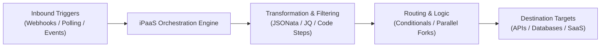

<p align="center">
  
</p>

<p align="center">
  <a href="https://github.com/ishandutta2007/Awesome-Awesome-Awesome"></a><a href="https://discord.gg/jc4xtF58Ve"></a>
  <a href="https://github.com/ishandutta2007/Awesome-Integration-Platform-Ipaas/stargazers"></a>
  <a href="https://github.com/ishandutta2007/Awesome-Integration-Platform-Ipaas/network/members"></a>
  <a href="https://github.com/ishandutta2007/Awesome-Integration-Platform-Ipaas/issues"></a>
  <a href="https://github.com/ishandutta2007/Awesome-Integration-Platform-Ipaas/blob/main/LICENSE"></a>
  <a href="https://github.com/ishandutta2007"></a>
</p>

---

# 🚀 Awesome Integration Platform (iPaaS) Ecosystem

> **A comprehensive, SEO-optimized curated directory of enterprise SaaS Integration Platforms as a Service (iPaaS), self-hosted workflow automation engines, and open-source connectivity tools.**

Welcome to the definitive index of **Integration Platform as a Service (iPaaS)** technologies. Modern engineering organizations and enterprises rely on these platforms to connect disparate SaaS tools, automate mission-critical data flows, orchestrate business logic across cloud and on-premises infrastructure, and dismantle brittle point-to-point API spaghetti.

Whether you are seeking an enterprise-grade cloud iPaaS with pre-built compliance and ERP connectors, a flexible no-code automation canvas, or a sovereign, self-hosted open-source alternative (like **n8n**, **Activepieces**, or **Apache Camel**) to avoid steep usage-based pricing tiers, this guide provides actionable intelligence, precise pricing breakdowns, and real-time star metrics.

---

## 📑 Table of Contents

- [📊 Sector Overview & Market Dynamics](#-sector-overview--market-dynamics)
- [☁️ Top SaaS Integration Platforms (iPaaS)](#️-top-saas-integration-platforms-ipaas)
- [💻 Open-Source GitHub Projects (Self-Hosted iPaaS & Automation)](#-open-source-github-projects-self-hosted-ipaas--automation)
- [🔍 Key Architectural Patterns in iPaaS](#-key-architectural-patterns-in-ipaas)
- [🤝 How to Contribute](#-how-to-contribute)
- [💖 Support & Community](#-support--community)
- [⭐ Star History](#-star-history)
- [📜 Disclaimer & License](#-disclaimer--license)

---

## 📊 Sector Overview & Market Dynamics

The global **Integration Platform as a Service (iPaaS)** market was valued at approximately **$11.2 Billion in 2024** and is projected to expand at an aggressive compound annual growth rate (CAGR) of **28.5%**, surpassing **$48.5 Billion by 2032**. Rapid enterprise cloud migration, explosion of vertical SaaS point solutions, and the urgent mandate to integrate autonomous AI agents into core transactional workflows are fueling exponential adoption.

The sector exhibits **moderate fragmentation**:
- **Enterprise Giants & Hyperscalers**: Mega-cap technology corporations such as **Microsoft (Power Automate)**, **Salesforce (MuleSoft)**, **ServiceNow (IntegrationHub)**, and **Informatica** anchor multi-million-dollar annual recurring revenue (ARR) agreements within Fortune 500 enterprises. Their competitive moat relies heavily on deep ecosystem bundling, hybrid runtime compliance (FedRAMP, HIPAA), and unified governance.
- **Mid-Market & Agile SaaS Automators**: Specialized players like **Zapier**, **Make (Celonis)**, **Workato**, **Boomi**, and **Celigo** dominate SMBs, departmental units, and growth-stage companies with rapid low-code/no-code onboarding, rich third-party app stores, and pre-packaged e-commerce/fintech integrations.
- **Open-Source & Self-Hosted Sovereign Challengers**: Far from a "winner-take-all" landscape, rising API volume consumption costs and data residency mandates have sparked explosive momentum for open-source alternatives like **n8n**, **Activepieces**, and **Windmill**. These platforms empower software engineering teams to maintain total control over sensitive customer payloads with zero per-step execution penalties.

---

## ☁️ Top SaaS Integration Platforms (iPaaS)

The table below presents leading SaaS iPaaS platforms, sorted in descending order by **Company Size (Market Capitalization or Valuation)**. Pricing and free tier quotas represent verified starting tiers.

| Platform / Service | Company Size (Valuation / Market Cap) | Starting Tier Pricing | Free Tier / Trial Limits | Key Capabilities & Primary Focus |
| :--- | :--- | :--- | :--- | :--- |
| 🌐 **[Microsoft Power Automate](https://powerautomate.microsoft.com/)** | **$3.1 Trillion** *(Market Cap)* | **$15/user/month** *(Power Automate Premium)* or **$150/bot/month** *(Process license)* | **Free Forever** included with Microsoft 365 (standard cloud connectors); **90-day free trial** of Premium with 5,000 AI Builder credits and desktop RPA | Cloud and desktop robotic process automation (RPA), deep native Microsoft 365, Azure, Dynamics, and Copilot AI ecosystem integration. |
| 🔌 **[MuleSoft Anypoint Platform](https://www.mulesoft.com/)** *(Salesforce)* | **$280 Billion** *(Parent Market Cap; MuleSoft ~$2.5B ARR)* | **$27,000/year** *(Starter package, billed annually)* | **30-day free trial** with 1 vCore runtime allocation, Exchange connector hub, and Design Center studio access | API-led connectivity, hybrid on-prem/cloud execution engine (CloudHub & Mule Runtime), full API lifecycle management, and enterprise ESB transformation. |
| 🏢 **[ServiceNow IntegrationHub](https://www.servicenow.com/)** | **$190 Billion** *(Market Cap)* | **$1,200/month** *(IntegrationHub Starter transaction bundle)* | **Free Forever** on Personal Developer Instances (PDI) with Starter pack (up to 1,000 spoke executions/day; hibernates after 10 days inactivity) | Native orchestration directly within ServiceNow Now Platform; out-of-the-box spokes for Jira, Slack, SAP, and enterprise IT/HR/SecOps automation. |
| 🎨 **[Make](https://www.make.com/)** *(Celonis)* | **$13.0 Billion** *(Parent Valuation; Make ~$50M ARR)* | **$9.00/month** *(Core plan, billed annually; $10.59/mo billed monthly)* | **Free Forever**: 1,000 operations/month, 100 MB data transfer, 2 active scenarios, 15-minute execution frequency | Highly visual interactive canvas featuring conditional branching, multidimensional routers, data aggregators, and granular JSON/REST manipulation. |
| 🗄️ **[Informatica Cloud (IDMC)](https://www.informatica.com/)** | **$8.5 Billion** *(Market Cap)* | **$2,000/month** *(Pay-As-You-Go with Informatica Processing Units at $3.25/IPU)* | **Free Forever**: up to 500 compute hours/month with 100+ connectors; or **30-day full enterprise trial** with CLAIRE AI copilot | Enterprise cloud data governance, master data management (MDM), mass ELT/ETL ingestion, and mission-critical multi-cloud data warehousing pipelines. |
| ⚡ **[Workato](https://www.workato.com/)** | **$5.7 Billion** *(Valuation)* | **$10,000/year** *(Base platform workspace)* + **$99/recipe/month** | **30-day free trial** upon verified business request with 1 workspace, 5 active recipe integrations, and community connectors | Enterprise workflow orchestration powered by GenAI recipes, embedded enterprise governance, role-based access control (RBAC), and low-code connectors. |
| ⚡ **[Zapier](https://zapier.com/)** | **$5.0 Billion** *(Valuation)* | **$19.99/month** *(Starter plan billed annually; $29.99/mo billed monthly) for 750 tasks/mo* | **Free Forever**: 100 tasks/month, 5 active single-step Zaps, 15-minute polling interval | Unrivaled third-party app ecosystem (7,000+ connectors), no-code trigger-and-action builder, Canvas visual orchestration, and AI-assisted Zap generation. |
| 🔗 **[Boomi](https://boomi.com/)** *(Francisco Partners / TPG)* | **$4.0 Billion** *(Acquisition Valuation)* | **$2,000/month** *(Base edition with standard SaaS connectors)* | **30-day free trial** with full AtomSphere platform capabilities, unlimited integration building, and hybrid Atom runtime deployment | Pioneer cloud-native iPaaS with distributed lightweight Atom engine (runs on-premises or cloud), B2B/EDI transaction management, and API lifecycle catalog. |
| 🔄 **[Jitterbit Harmony](https://www.jitterbit.com/)** | **$1.2 Billion** *(Valuation)* | **$1,000/month** *(Standard tier for up to 3 application endpoints)* | **30-day free trial** with Harmony Cloud Studio access, pre-built process templates, and enterprise endpoint sandboxes | High-velocity API creation, bidirectional ERP/CRM synchronization (SAP, Salesforce, NetSuite, Oracle), and low-code EDI trading partner integration. |
| 🧠 **[SnapLogic](https://www.snaplogic.com/)** | **$1.0 Billion** *(Valuation)* | **$9,995/year** *(Starter subscription, ~ $833/month)* | **30-day free trial** with Iris AI smart pipeline recommendations, core Snaps connectors, and distributed Snaplex runtime sandbox | Generative-integration-focused architecture, autonomous pipeline recommendation, streaming ETL/ELT, and enterprise microservice integration. |
| 🎛️ **[Tray.io](https://tray.io/)** | **$650 Million** *(Valuation)* | **$595/month** *(Pro plan with 250,000 task quota)* | **14-day free trial** with full visual workflow builder access, universal SaaS connector library, and 5,000 test execution credits | Elastic, serverless integration engine for technical business operations, Merlin AI copilot, webhook routing, and custom authentication handlers. |
| 📦 **[Celigo Integrator.io](https://www.celigo.com/)** | **$500 Million** *(Valuation)* | **$600/month** *(Standard tier for Integrator.io core)* | **Free Forever**: 1 active integration flow, 500 records/month, standard SaaS endpoints; plus **30-day full-feature trial** | Focused on mid-market and enterprise e-commerce (Shopify, Amazon, NetSuite, Salesforce), automated order-to-cash, and inventory synchronization. |

---

## 💻 Open-Source GitHub Projects (Self-Hosted iPaaS & Automation)

The following open-source workflow automation engines, enterprise integration frameworks, and distributed pipeline orchestrators are sorted in strictly descending order by **GitHub_Stars_Count**. Each repository badge links directly to its stargazer community.

---

### 1. [n8n](https://github.com/n8n-io/n8n) [](https://github.com/n8n-io/n8n/stargazers)
- **License**: Sustainable Use License (Fair-code)
- **Primary Stack**: TypeScript, Node.js, Vue.js, Docker
- **Overview**: The most popular open-source workflow automation platform globally. Features a node-based visual editor with 400+ native connectors, advanced webhook receivers, JavaScript/Python code execution steps, and native LangChain AI agent integration. Offers self-hosted deployment via Docker or Kubernetes with no arbitrary execution rate limits.

---

### 2. [Huginn](https://github.com/huginn/huginn) [](https://github.com/huginn/huginn/stargazers)
- **License**: MIT License
- **Primary Stack**: Ruby on Rails, MySQL / PostgreSQL
- **Overview**: A legendary hackable automation engine for building autonomous agents that monitor the web, scrape content, react to events, and trigger HTTP calls. Often referred to as an open-source, private self-hosted alternative to IFTTT and Zapier.

---

### 3. [Conductor](https://github.com/conductor-oss/conductor) [](https://github.com/conductor-oss/conductor/stargazers)
- **License**: Apache-2.0 License
- **Primary Stack**: Java, Spring Boot, React, Elasticsearch / Redis
- **Overview**: Microservices orchestration engine originally built and open-sourced by Netflix. Coordinates high-scale distributed services across cloud boundaries with resilient JSON-defined workflows, asynchronous tasks, state machines, and built-in human tasks.

---

### 4. [Kestra](https://github.com/kestra-io/kestra) [](https://github.com/kestra-io/kestra/stargazers)
- **License**: Apache-2.0 License
- **Primary Stack**: Java, Micronaut, Vue.js, Kafka / PostgreSQL
- **Overview**: An enterprise-grade, event-driven orchestration and automation platform. Allows developers to define declarative workflows in YAML or via a rich UI with 600+ integration plugins. Handles both real-time microservice integrations and high-throughput data processing workflows with distributed worker architecture.

---

### 5. [Activepieces](https://github.com/activepieces/activepieces) [](https://github.com/activepieces/activepieces/stargazers)
- **License**: MIT License
- **Primary Stack**: TypeScript, Node.js, Angular, PostgreSQL, Redis
- **Overview**: A modern, clean, 100% MIT-licensed no-code workflow automation tool. Features an intuitive visual flow builder, 500+ pre-built community "pieces" (connectors), built-in MCP server compatibility for LLM agent integration, sandboxed code execution, and single-container self-hosting.

---

### 6. [NocoBase](https://github.com/nocobase/nocobase) [](https://github.com/nocobase/nocobase/stargazers)
- **License**: AGPL-3.0 License
- **Primary Stack**: Node.js, React, TypeScript, PostgreSQL / MySQL / SQLite
- **Overview**: An extensible no-code/low-code development platform with deep relational database integration, custom REST API generation, and a built-in workflow engine. Ideal for organizations seeking to combine internal tooling with automated external integration pipelines.

---

### 7. [Prefect](https://github.com/PrefectHQ/prefect) [](https://github.com/PrefectHQ/prefect/stargazers)
- **License**: Apache-2.0 License
- **Primary Stack**: Python, FastAPI, Vue.js
- **Overview**: Modern workflow orchestration engine that coordinates mission-critical data integrations and microservice tasks into transparent, observable Python pipelines with native async execution, dynamic task mapping, and automated retry policies.

---

### 8. [Temporal](https://github.com/temporalio/temporal) [](https://github.com/temporalio/temporal/stargazers)
- **License**: MIT License
- **Primary Stack**: Go, TypeScript, Java, Python
- **Overview**: Durable execution platform enabling developers to write resilient, code-first integration workflows that never fail due to network hiccups, downtime, or transient API outages. Powers mission-critical financial transactions, distributed sagas, and enterprise system synchronizations.

---

### 9. [Node-RED](https://github.com/node-red/node-red) [](https://github.com/node-red/node-red/stargazers)
- **License**: Apache-2.0 License
- **Primary Stack**: JavaScript, Node.js
- **Overview**: Flow-based visual programming tool originating from IBM. Connects hardware devices, IoT sensors, MQTT brokers, REST APIs, and online services together. Renowned for low resource footprint, running seamlessly on single-board computers (Raspberry Pi) and lightweight Docker containers.

---

### 10. [Airbyte](https://github.com/airbytehq/airbyte) [](https://github.com/airbytehq/airbyte/stargazers)
- **License**: ELv2 (Core is open code, free for internal use)
- **Primary Stack**: Java, Python, React, Docker
- **Overview**: The leading data integration and ELT pipeline engine. Offers 350+ connectors to replicate structured data from SaaS platforms, transactional databases, and APIs directly into data warehouses (Snowflake, BigQuery, ClickHouse) and vector databases.

---

### 11. [Windmill](https://github.com/windmill-labs/windmill) [](https://github.com/windmill-labs/windmill/stargazers)
- **License**: AGPL-3.0 License
- **Primary Stack**: Rust, Svelte, TypeScript, PostgreSQL
- **Overview**: Ultra-fast developer-centric integration platform that turns Python, TypeScript, Go, Bash, or SQL scripts into production-ready workflows and auto-generated user interfaces. Serves as a high-performance self-hosted alternative to Retool, Temporal, and Prefect.

---

### 12. [Argo Workflows](https://github.com/argoproj/argo-workflows) [](https://github.com/argoproj/argo-workflows/stargazers)
- **License**: Apache-2.0 License
- **Primary Stack**: Go, Kubernetes CRDs, TypeScript
- **Overview**: The Kubernetes-native workflow engine orchestrating parallel jobs on Kubernetes. Each step is executed as a container, enabling compute-heavy integration workloads, machine learning pipelines, and continuous data ingestion at massive enterprise scale.

---

### 13. [Automatisch](https://github.com/automatisch/automatisch) [](https://github.com/automatisch/automatisch/stargazers)
- **License**: AGPL-3.0 License
- **Primary Stack**: Node.js, React, PostgreSQL
- **Overview**: A privacy-first, business-friendly open-source Zapier alternative. Built specifically for organizations that cannot store credentials or customer data on US-based cloud multi-tenant infrastructure due to GDPR and strict privacy compliance.

---

### 14. [Debezium](https://github.com/debezium/debezium) [](https://github.com/debezium/debezium/stargazers)
- **License**: Apache-2.0 License
- **Primary Stack**: Java, Apache Kafka, Kafka Connect
- **Overview**: Distributed platform for Change Data Capture (CDC). Transforms legacy relational databases (PostgreSQL, MySQL, Oracle, SQL Server) into real-time event streams, enabling event-driven iPaaS integration architectures without polling delays.

---

### 15. [Apache Camel](https://github.com/apache/camel) [](https://github.com/apache/camel/stargazers)
- **License**: Apache-2.0 License
- **Primary Stack**: Java, Quarkus, Spring Boot, Camel-K
- **Overview**: The industry standard open-source enterprise integration framework implementing all Enterprise Integration Patterns (EIP). Features 300+ enterprise connectors, Kafka integrations, cloud endpoints, and native Kubernetes serverless execution via Camel K.

---

### 16. [Apache NiFi](https://github.com/apache/nifi) [](https://github.com/apache/nifi/stargazers)
- **License**: Apache-2.0 License
- **Primary Stack**: Java
- **Overview**: Robust, visual data logistics and flow management system. Excels at high-throughput data ingestion, backpressure regulation, multi-tenant security policies, and complete end-to-end data provenance tracking across complex edge-to-cloud topologies.

---

### 17. [ByteChef](https://github.com/bytechefhq/bytechef) [](https://github.com/bytechefhq/bytechef/stargazers)
- **License**: Apache-2.0 License
- **Primary Stack**: Java, Spring Boot, Vue.js
- **Overview**: An open-source, embeddable workflow automation and API integration platform. Designed specifically for SaaS software vendors seeking to embed out-of-the-box integration capabilities into their own applications.

---

### 18. [Cenit IO](https://github.com/cenit-io/cenit) [](https://github.com/cenit-io/cenit/stargazers)
- **License**: MIT License
- **Primary Stack**: Ruby, React, MongoDB
- **Overview**: A 100% open-source integration Platform as a Service (iPaaS) backend. Includes pre-built Odoo ERP synchronization, webhook listener engines, protocol parsers, and custom data schema mapping tools.

---

## 🔍 Key Architectural Patterns in iPaaS

When architecting integration pipelines, engineering teams typically choose between four core architectural paradigms:



1. **Trigger & Action (Event-Driven)**: Workflows execute asynchronously in response to webhooks or message bus events (Kafka, RabbitMQ, SQS). Best implemented using **n8n**, **Activepieces**, or **Zapier**.
2. **Scheduled Batch & Bulk Data Pipelines**: High-volume records moved incrementally via ELT models. Best served by **Airbyte** or **Informatica Cloud**.
3. **Enterprise Integration Patterns (EIP)**: Canonical data models, message routing, aggregators, and splitters handling legacy systems. Best suited for **Apache Camel** and **MuleSoft Anypoint**.
4. **Durable Code-First Orchestration**: Long-running sagas with state persistence and human-in-the-loop approvals. Best architected on **Temporal** or **Windmill**.

---

## 🤝 How to Contribute

We actively welcome contributions from integration engineers, SaaS founders, and open-source contributors! 🌟

1. **Fork the Repository** on GitHub.
2. **Create a Feature Branch**:
   ```bash
   git checkout -b feature/add-new-ipaas-tool
   ```
3. **Add or Update Entries**:
   - Maintain the existing tabular schema for SaaS platforms.
   - For open-source additions, include the official GitHub repo link and ensure the Stars_Badge uses the required `style=social&color=white` parameters.
   - Keep descriptions objective, accurate, and benchmarked.
4. **Submit a Pull Request**: Provide a brief summary of why the platform should be added or what metrics changed.

---

## 💖 Support & Community

Thank you so much for exploring this curated guide to Integration Platforms (iPaaS) and workflow automation ecosystems! 🎉

If this repository helped you discover the right integration tool, compare platforms, or architect self-hosted connectivity pipelines, please consider supporting the project:

- ⭐ **Star this repository** to help others discover it across GitHub.
- 🍴 **Fork the project** and contribute additions, connector updates, or benchmarks.
- 📢 **Share with colleagues**, integration engineers, and dev communities.
- ☕ **Sponsor & Buy a Coffee**: If you'd like to support ongoing curation and open-source tooling, visit the [GitHub Sponsors Dashboard](https://github.com/sponsors/ishandutta2007).

Your backing fuels high-quality, up-to-date open-source reference architectures! 🙌

---

##  Star History
[](https://star-history.dera.page/#ishandutta2007/Awesome-Integration-Platform-Ipaas&type=date&legend=top-left)

---

## 📜 Disclaimer & License

- This list is **community-curated** for educational, architectural, and research purposes.
- All trademarks, logos, and service marks belong to their respective corporate entities.
- Distributed under the [MIT License](file:///C:/Users/hp/Documents/Projects/Awesome-Integration-Platform-Ipaas/LICENSE).
